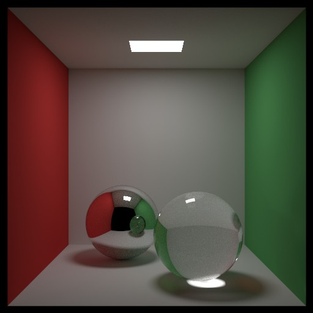
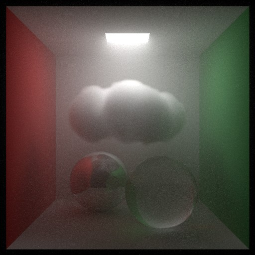
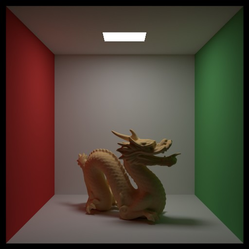
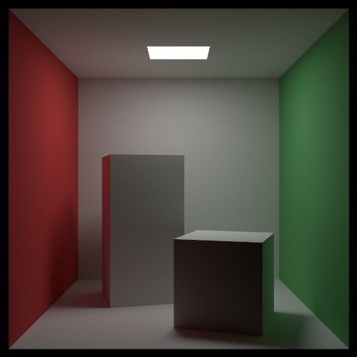
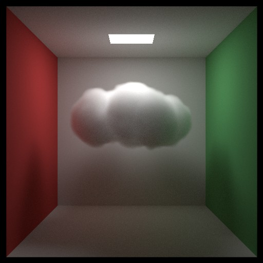
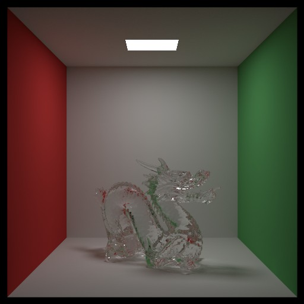
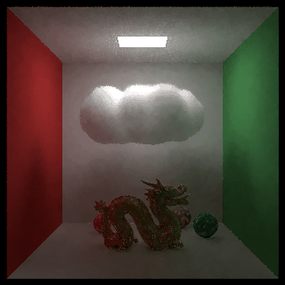
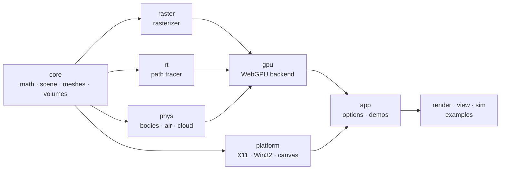

<div align="center">

# little_renderer

**A small rendering engine in plain C, written from scratch.**

A rasterizer, a path tracer and a physics engine that share one scene,
on the CPU or on the GPU through WebGPU, natively and in the browser.


  

</div>

---

## What it is

One engine with two ways of drawing the same `Scene`. The **rasterizer** answers *which
pixels does each triangle cover?* in milliseconds. The **path tracer** answers *what does
each pixel see?* with soft shadows, reflection, refraction, caustics and clouds. A
**physics engine** moves things inside the scene: rigid bodies, and the air that carries
a volumetric cloud. All of it is plain C on its own small math library, one static
library behind one header (`lr.h`), with no third-party code in the engine.

## Features

| | |
|---|---|
| **Path tracer** | Next event estimation with multiple importance sampling, mirror and glass, caustics traced from the lamp, Owen-scrambled Sobol with blue noise, volumetric clouds and fog (delta and ratio tracking), SAH BVH (4-wide on the CPU), instanced meshes in a two-level tree |
| **Rasterizer** | Edge functions, perspective-correct shading (flat, Gouraud, Phong, wireframe), multithreaded; clouds and fog raymarched over the frame |
| **GPU (WebGPU)** | Every backend again in WGSL compute and render shaders: the rasterizer, the path tracer with an SVGF-style denoiser and temporal reprojection for real-time path tracing, light-traced caustics with a photon cache, a GPU BVH builder, the air and the cloud, the rigid bodies |
| **Physics** | Spheres, boxes, convex hulls and triangle meshes (separating axes, sequential impulses with warm starting, mass splitting on the GPU), the air as Stable Fluids on a MAC grid with a multigrid pressure solve, a MacCormack-advected cloud, explosions; bodies push the air and the air drags them |
| **Platforms** | Linux (X11), Windows (Win32, MSYS2), web browsers (Emscripten + WebGPU); `float` or `double` precision |

## Gallery

| | | |
|:---:|:---:|:---:|
|  |  |  |
| The Cornell box | A procedural cloud | A glass dragon (871k triangles) |

<div align="center">

<br><sub>Convex-hull dragons fall through the cloud onto a fixed one; the air flows around them and drags the cloud. Physics and path tracing on the GPU.</sub>
</div>

## Quick start

```sh
make models          # the test models (needs uv or python3, once)
make                 # the library, the programs, the examples
bin/view             # fly through the Cornell box: WASD + mouse, M changes mode
bin/render           # a path traced image -> out/cornell_boxes.ppm
bin/view -sim on     # the physics, live (Space pauses, K is an explosion)

make deps && make    # use the GPU natively (fetches wgpu-native)
make web && make serve   # the same in a browser: http://localhost:8000
```

Every program lists its options with `-h`; all of them are in [docs/USAGE.md](docs/USAGE.md).
To build your own program on the engine, start with `examples/hello_rt.c` (40 lines) and
[docs/SDK.md](docs/SDK.md).

## How it is built



Each layer only includes the ones before it (`make check-layers` checks), so the
backends and the physics never depend on each other, and the CPU versions always stay
next to the GPU ones.

## Performance

Measured on an RTX 3070 and an 8-core CPU ([docs/PERFORMANCE.md](docs/PERFORMANCE.md)
keeps every measurement, and the ideas still to try):

| | |
|---|---|
| Cornell box, 640×640, one sample per pixel | **1.9 ms** on the GPU |
| Stanford dragon, 871k triangles | **8.1 ms** per pass on the GPU · 3.4 M paths/s on the CPU |
| Live path traced dragon (`view -backend rt`), 640×640 | **79 fps**, denoised |
| 1024 rigid bodies, one 1/60 s step | 20 ms on the CPU → **1.1 ms** on the GPU |

## Documentation

| | |
|---|---|
| [USAGE](docs/USAGE.md) | every command, option, key and tunable constant |
| [SDK](docs/SDK.md) | using the engine in your own program, the API |
| [RAYTRACER](docs/RAYTRACER.md) | the path tracer, from rays to MIS, with the maths |
| [RASTERIZER](docs/RASTERIZER.md) | the rasterizer, milestone by milestone |
| [VOLUMES](docs/VOLUMES.md) | volumetric clouds and fog |
| [PHYSICS](docs/PHYSICS.md) | rigid bodies, the air, the coupling |
| [WEB](docs/WEB.md) | the GPU backend and the browser build |
| [PERFORMANCE](docs/PERFORMANCE.md) | how to measure, what was measured, what is next |

## Credits

The Stanford dragon (`models/dragon_recon/`, `make dragon-download`) is from the
[Stanford 3D Scanning Repository](https://graphics.stanford.edu/data/3Dscanrep/),
© Stanford University Computer Graphics Laboratory, used for non-commercial purposes
with credit. The techniques come from the papers and books cited in each document under
`docs/`.
