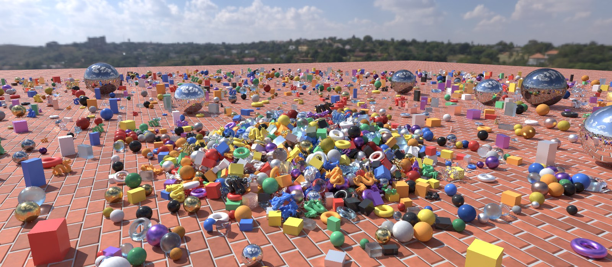
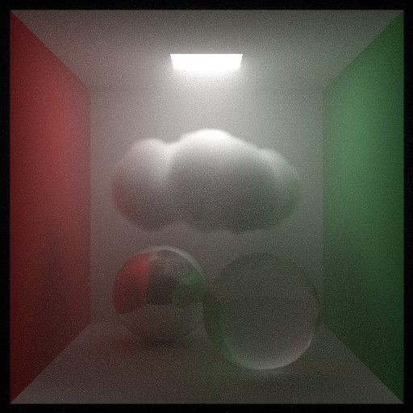
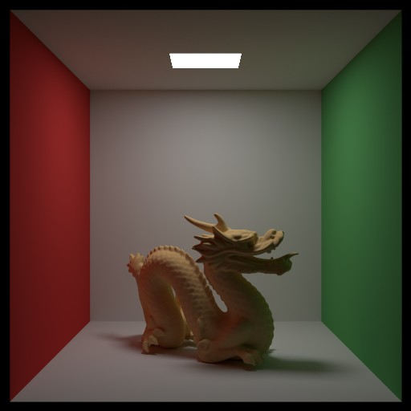
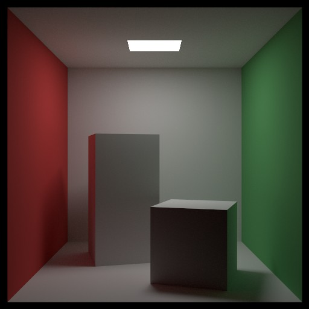
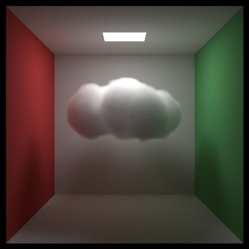
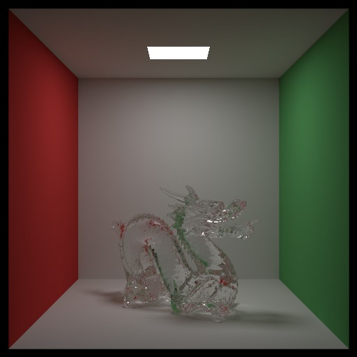
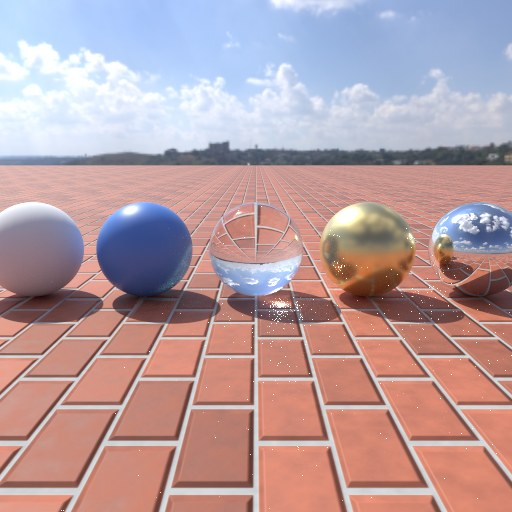
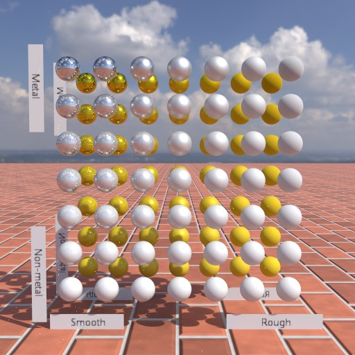
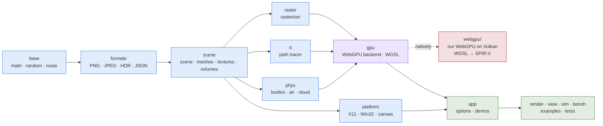

<div align="center">

# little_renderer

### A rendering engine in plain C, written from scratch

**A rasterizer, a path tracer and a physics engine that share one scene,
on the CPU or on the GPU: through WebGPU, or through our own WebGPU on Vulkan
with hardware ray tracing, natively and in the browser.**


[**Features**](#-features) · [**Gallery**](#-gallery) · [**Quick start**](#-quick-start) · [**How it is built**](#-how-it-is-built) · [**Performance**](#-performance) · [**Docs**](#-documentation)


<br><sub><b>5000 instances under an HDR sky.</b> 2000 bodies of 14 physically based materials (gold, copper, chrome, glass, plastics, ceramic, rubber...) rain down and pile up, simulated on the GPU, among 3000 still props. Live it is path traced and denoised at 1280×720: <b>53 frames/s</b> on our Vulkan layer with hardware ray tracing (<code>bin/view -sim on -demo sky -backend rt</code>, RTX 3070). This frame has 256 samples per pixel.</sub>

</div>

---

## 💡 What it is

One engine with two ways of drawing the same `Scene`. The **rasterizer** answers *which
pixels does each triangle cover?* in milliseconds. The **path tracer** answers *what does
each pixel see?*, with soft shadows, reflection, refraction, caustics and clouds. A
**physics engine** moves things inside the scene: rigid bodies, and the air that carries
a volumetric cloud.

Every one of them exists twice, on the CPU in C and on the GPU in WGSL, side by side, so
each GPU kernel can be checked against the C it came from. All of it is plain C on its own
small math library: one static library behind one header (`lr.h`), with **no third-party
code in the engine**. Even the files are read by our own code: PNG, JPEG, Radiance HDR,
JSON and glTF.

<table>
<tr>
<td align="center"><b>~24k</b><br><sub>lines of C in the engine</sub></td>
<td align="center"><b>~7k</b><br><sub>lines of C for our WebGPU on Vulkan and its WGSL compiler</sub></td>
<td align="center"><b>79</b><br><sub>WGSL shaders, ~6.5k lines</sub></td>
<td align="center"><b>4</b><br><sub>pipelines: CPU and GPU, raster and path traced</sub></td>
<td align="center"><b>3</b><br><sub>platforms: Linux, Windows, the browser</sub></td>
</tr>
</table>

### Every pipeline, everywhere

| | CPU | GPU natively: our WebGPU on Vulkan | Browser (its WebGPU) |
|---|:---:|:---:|:---:|
| **Rasterizer** (PBR, light probes, HDR skies) | ✅ | ✅ | ✅ |
| **Path tracer** (MIS, glass, caustics, media) | ✅ | ✅ + hardware ray queries | ✅ |
| **Denoised real-time path tracing** (SVGF-style, reprojection) | | ✅ | ✅ |
| **Rigid bodies** (spheres, boxes, hulls, meshes) | ✅ | ✅ | ✅ |
| **Air and cloud** (Stable Fluids, multigrid) | ✅ | ✅ | ✅ |

One engine written against WebGPU (`webgpu.h` and WGSL): natively our own implementation of
it on Vulkan, in a page the browser's. No WebGPU library is linked natively (wgpu-native,
used until 2026-11-18, is gone).

`float` or `double` precision for the whole engine, chosen when it is built.

## ✨ Features

| | |
|---|---|
| **Path tracer** | Next event estimation with multiple importance sampling, physically based materials (glTF metallic-roughness: GGX microfacets with visible-normal sampling, rough glass, multiple-scattering compensation; base colour, metallic-roughness and normal map textures), HDR skies (Radiance `.hdr`) sampled by luminance, caustics traced from the lamp, Owen-scrambled Sobol with blue noise, volumetric clouds and fog (delta and ratio tracking), SAH BVH (4-wide on the CPU), instanced meshes in a two-level tree |
| **Rasterizer** | Edge functions, perspective-correct shading (flat, Gouraud, Phong, wireframe) with the path tracer's BSDF and glTF's textures (base colour, metallic-roughness, normal maps; trilinear mip-mapping), lit by the area lamp and a light probe or an HDR sky (split-sum, parallax-corrected) with an irradiance grid, multithreaded; clouds and fog raymarched over the frame |
| **GPU (WebGPU)** | Every backend again in WGSL compute and render shaders: the rasterizer, the path tracer with an SVGF-style denoiser and temporal reprojection for real-time path tracing, light-traced caustics with a photon cache, GPU tree builders (LBVH and PLOC), the air and the cloud, the rigid bodies. Offline GPU renders are bit-reproducible: the same image every run |
| **Our own Vulkan layer** | the native build's GPU: the `webgpu.h` API implemented on Vulkan 1.3 from scratch (our own declarations of Vulkan, no SDK, no library linked; Win32 and X11 windows), with our own WGSL → SPIR-V compiler; hardware ray tracing through ray queries (an extension of `webgpu.h` of our own), which makes the path tracer up to 2.7× faster; a lost device falls back to the CPU; clean under the Khronos validation layer ([VULKAN.md](docs/VULKAN.md)) |
| **Physics** | Spheres, boxes, convex hulls and triangle meshes (separating axes, contacts found once per step with speculative margins, sequential impulses with warm starting, sleeping bodies; on the GPU over-relaxed Jacobi iterations with mass splitting, a grid broad phase, the hull pairs' last separating feature remembered), the air as Stable Fluids on a MAC grid with a multigrid pressure solve, a MacCormack-advected cloud, explosions; bodies push the air and the air drags them |
| **Files** | Our own readers and writers: glTF 2.0 models (`.gltf`, `.glb`: meshes, the node tree, materials and textures), PNG (read and write), JPEG (baseline and progressive, the same pixels as libjpeg), Radiance `.hdr`, `.obj` and ASCII `.ply`, JSON |
| **Platforms** | Linux (X11), Windows (Win32, MSYS2), web browsers (Emscripten + WebGPU); `float` or `double` precision |

## 🖼️ Gallery

<div align="center">

<br><sub>A glTF model with its JPEG textures, normal map and glowing visor, path traced under an HDR sky on the GPU (4096 samples per pixel, 31 s at 1600×700)</sub>
</div>

<br>

| | | |
|:---:|:---:|:---:|
|  |  |  |
| Mirror and glass, with caustics | Glass in a cloud and fog | The Stanford dragon |
|  |  |  |
| The Cornell box | A procedural cloud | A glass dragon (871k triangles) |
|  |  |  |
| Physically based materials under an HDR sky | glTF's metallic × roughness sweep | Mirror dragon, glTF helmet, glass torus, cloud |

<div align="center">

<br><sub><b>One scene, two renderers:</b> path traced (left) and rasterized in real time with light probes, an irradiance grid and the same BSDF (right)</sub>
<br><br>
 
<br><sub><b>Left:</b> convex-hull dragons fall through the cloud onto a fixed one; the air flows around them and drags the cloud. <b>Right:</b> the rain of the picture at the top, its first 17 seconds. Physics and path tracing on the GPU.</sub>
</div>

## 🚀 Quick start

You need `gcc` and `make` (on Windows, an MSYS2 UCRT64 shell), and libX11 on Linux.

```sh
make models          # the test models, HDR skies, glTF samples and the dragon (uv or python3; ~41 MB, once)
make                 # the library, the programs, the examples and the tests
make test            # 14 unit tests (the GPU ones skip without a GPU)

bin/view             # fly through the Cornell box: WASD + mouse, M changes mode
bin/render           # a path traced image -> out/cornell_boxes.png
bin/view -sim on     # the physics, live (Space pauses, K is an explosion)
```

<table>
<tr><th>On the GPU, natively</th><th>In a browser</th></tr>
<tr>
<td>

```sh
make        # GPU through our Vulkan layer
bin/view -backend rt
```

</td>
<td>

```sh
make web    # Emscripten
make serve  # localhost:8000
```

</td>
</tr>
</table>

The showcase at the top of this page, live: 5000 instances under an HDR sky, 2000 of them
raining down, with physics and path tracing on the GPU:

```sh
bin/view -sim on -demo sky -backend rt -sky models/skies/kloofendal_48d_partly_cloudy_2k.hdr -width 1280 -height 720
```

<details>
<summary><b>Keys in the viewer</b></summary>

| key | what it does |
|---|---|
| `W` `A` `S` `D`, `E` / `Q`, mouse | fly: forward, left, back, right, up, down; look around |
| `M` | mode: hybrid → path traced → rasterized |
| `V` | raster shading: Phong → Gouraud → flat → wireframe |
| `X` | GPU path tracing: denoiser on / off |
| `L` | rasterizer: make the light probe again |
| `P` | save what the window shows as PNG |
| `C` | print a `render` command that path traces exactly this view |
| `Space` · `K` · `N` · `T` | simulation: pause · an explosion · drop a steel ball · restart |
| `H` | all the controls, in the terminal |

</details>

Every program lists its options with `-h`; all of them are in [docs/USAGE.md](docs/USAGE.md).
To build your own program on the engine, start with `examples/hello_rt.c` (40 lines) and
[docs/SDK.md](docs/SDK.md).

## 🧱 How it is built



Each layer only includes the ones before it (`make check-layers` checks), so the
backends and the physics never depend on each other, and the CPU versions always stay
next to the GPU ones.

| folder | what is in it |
|---|---|
| `engine/` | the library, `liblr.a`: one folder per layer above (`base/`, `formats/`, `scene/`, `raster/`, `rt/`, `phys/`, `platform/`, `gpu/`, `app/`); include `engine/lr.h` |
| `engine/gpu/shaders/` | the WGSL, by what it serves: `common/`, `view/`, `raster/`, `trace/`, `rigid/`, `fluid/` |
| `webgpu/` | our WebGPU on Vulkan (`vk/`) and its WGSL → SPIR-V compiler (`wgsl/`), the native build's GPU; they use nothing of the engine. `webgpu/include/` holds the standard `webgpu.h`, the one file not written here |
| `apps/` | the programs `render`, `view`, `sim` and `bench` (the benchmarks) |
| `examples/` | small programs on the library, to start from |
| `tests/` | the unit tests, `make test` |
| `tools/` | Python and C helpers: models, test data, GIFs, the shader embedding, the Vulkan header check |
| `web/` | the page around the WebAssembly build |
| `docs/` | how everything works and how fast it is |

## ⚡ Performance

Measured with the performance suite (`make perf`, `make web-bench`) on
`main` at 6fe55ba: RTX 3070, 12 CPU threads, Windows. Nothing waits for the display (offscreen,
and the viewer with `-vsync off`), so these are the fastest the machine goes.
[docs/STATUS.md](docs/STATUS.md) has every case and the ideas still to try. The first column is
wgpu-native, the native WebGPU library used until 2026-11-18, kept here for comparison.

| | wgpu-native (until 2026-11-18) | our Vulkan layer | Chrome |
|---|---|---|---|
| Cornell box, 640×640, one path traced sample per pixel | 2.25 ms | **1.27 ms** | 3.82 ms |
| Stanford dragon, 871k triangles, one pass | 8.32 ms | **1.34 ms** (hardware rays) | |
| The helmet (glTF, textured), one pass | 5.30 ms | **1.76 ms** | 9.74 ms |
| The sky demo with 48k instances, 1280×720, one pass | 17.7 ms | **3.97 ms** | 29.0 ms |
| The same scene rasterized, a frame | 1.61 ms | 1.65 ms | 1.83 ms |
| The denoiser, 1280×720 | 1.98 ms | **1.59 ms** | 1.83 ms |
| 1000 rigid bodies falling, one 1/60 s step | 3.45 ms (GPU 1.18) | **1.74 ms** | 4.10 ms |
| The viewer, Cornell box rasterized, 1280×720 | 3566 fps | 3598 fps | |
| The viewer, Cornell box path traced and denoised, still | 201 fps, 178 passes/s | **223 fps, 339 passes/s** | |
| The viewer, sky demo with 2000 bodies falling, path traced and denoised | 64 fps | **103 fps** | |

On the CPU, for comparison: the dragon path traced at 3.8 M paths/s on 12 threads, the 1000
bodies in 21.9 ms a step (44.4 on one thread), the Cornell box rasterized in 23.6 ms.

## 🧪 Quality

- **14 unit tests** (`make test`): PNG and JPEG against other encoders, the BSDF in C and
  in WGSL, environments, textures, glTF, the volume sampling, the physics against exact
  answers, and on the GPU the basics, the rigid bodies and the air against the CPU, ray
  queries, and the path tracer traced twice to the same bit.
- **64 reference images**, CPU and GPU, rasterized and path traced, compared pixel for
  pixel across changes.
- **Every build kept clean**, without warnings: Windows (our Vulkan layer, CPU only, `double`),
  Linux (our Vulkan layer, CPU only, `float` and `double`) and the browser.
- **The Khronos validation layer** finds nothing in our Vulkan layer, across the tests,
  the viewer, `sim` and `render`.
- **Layers checked** by `make check-layers` on every build.

## 📚 Documentation

| | |
|---|---|
| [USAGE](docs/USAGE.md) | every command, option, key and tunable constant |
| [SDK](docs/SDK.md) | using the engine in your own program, the API |
| [RAYTRACER](docs/RAYTRACER.md) | the path tracer, from rays to MIS, with the maths |
| [RASTERIZER](docs/RASTERIZER.md) | the rasterizer, milestone by milestone |
| [VOLUMES](docs/VOLUMES.md) | volumetric clouds and fog |
| [PHYSICS](docs/PHYSICS.md) | rigid bodies, the air, the coupling |
| [WEB](docs/WEB.md) | the GPU backend and the browser build |
| [VULKAN](docs/VULKAN.md) | our own `webgpu.h` on Vulkan, the WGSL compiler, hardware ray tracing |
| [STATUS](docs/STATUS.md) | what comes next and how fast it runs now: the next steps, the latest measurements, the ideas, the backlog and the history |
| [PBR](docs/PBR.md) | physically based materials in every pipeline |

## 📄 Licence

[Boost Software License 1.0](LICENCE).

## 🙏 Credits

The Stanford dragon (`models/dragon_recon/`, `make dragon-download`) is from the
[Stanford 3D Scanning Repository](https://graphics.stanford.edu/data/3Dscanrep/),
© Stanford University Computer Graphics Laboratory, used for non-commercial purposes
with credit. The glTF sample models (`models/gltf/`, `make gltf-download`) are from
[Khronos's glTF-Sample-Assets](https://github.com/KhronosGroup/glTF-Sample-Assets): the
test models by Ed Mackey, Analytical Graphics (CC BY 4.0), the textured box by Cesium (CC BY
4.0); the damaged helmet is ctxwing's rebuild (CC BY 4.0) of theblueturtle_'s model (CC BY-NC
4.0), so its pictures here are for non-commercial use. The HDR sky in the pictures is Poly Haven's
[Kloofendal 48d Partly Cloudy](https://polyhaven.com/a/kloofendal_48d_partly_cloudy) (CC0).
The techniques come from the papers and books cited in each document under `docs/`.

<details>
<summary><b>How the pictures on this page were made</b></summary>

The pictures were made with (after `make models`, which downloads the sky and the models):

```sh
K=models/skies/kloofendal_48d_partly_cloudy_2k.hdr
bin/render -scene sky -sky $K -skyrot 120 -gltf models/gltf/DamagedHelmet.glb -rot 35 \
    -cam 60,190,-360 -look 278,140,300 -fov 32 -width 1600 -height 700 -s 4096
bin/render -scene sky -sky $K -cam 278,210,-470 -look 278,60,300 -fov 52 -n 512 -s 4096
bin/render -scene sky -sky $K -skyrot 200 -gltf models/gltf/MetalRoughSpheres.glb \
    -cam 278,200,-300 -look 278,170,300 -fov 40 -n 512 -s 4096
bin/render -scene showcase -n 512 -s 4096
bin/sim -demo sky -sky $K -fps 2 -frames 40 -width 1600 -height 700 -s 256 -gif off   # its last frame
bin/sim -demo sky -sky $K -fps 8 -frames 140 -width 360 -height 203 -s 512 -gif off   # the GIF's frames
```

</details>
