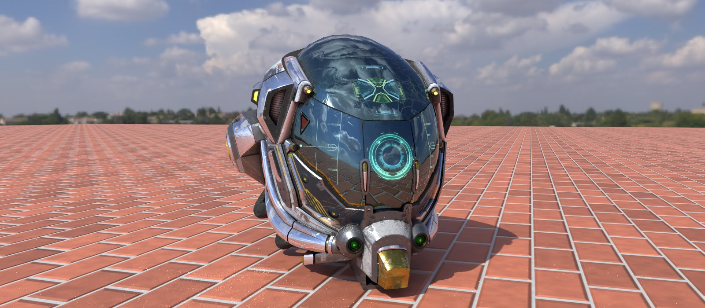
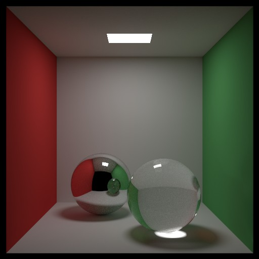
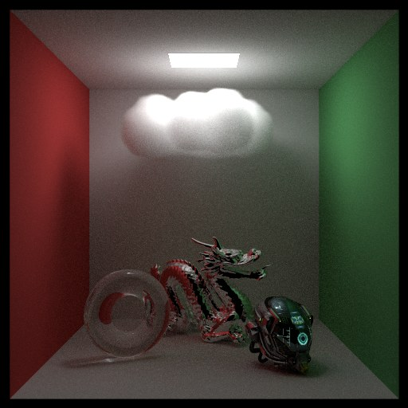
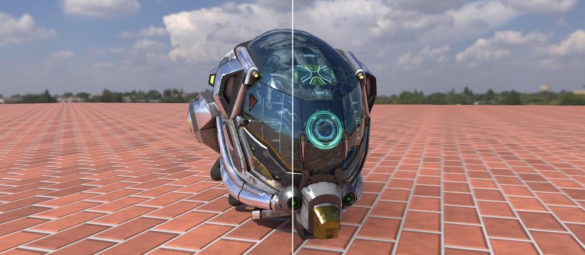
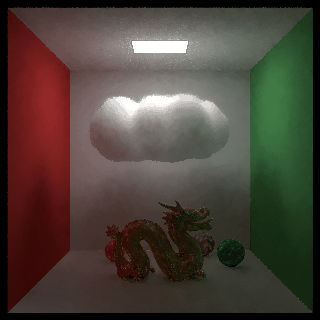
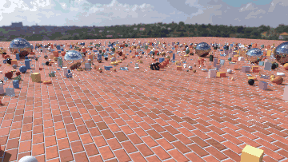
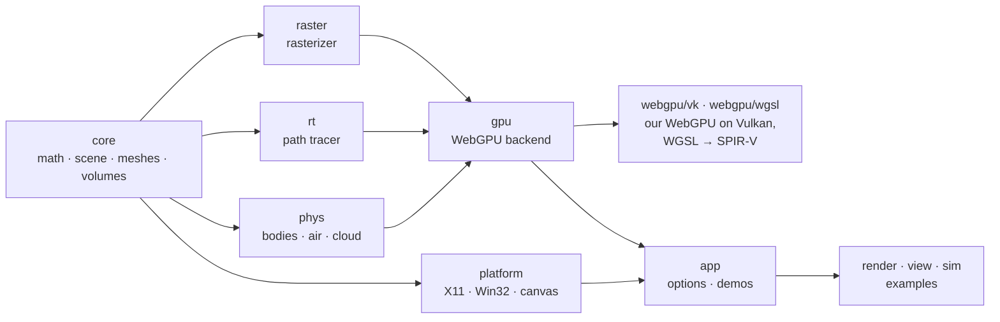

<div align="center">

# little_renderer

**A small rendering engine in plain C, written from scratch.**

A rasterizer, a path tracer and a physics engine that share one scene,
on the CPU or on the GPU: through WebGPU, or our own WebGPU on Vulkan with
hardware ray tracing, natively and in the browser.



<br><sub>A glTF model with its JPEG textures, normal map and glowing visor, path traced under an HDR sky on the GPU (4096 samples per pixel, 31 s at 1600×700)</sub>

  

</div>

---

<div align="center">

<br><sub>5000 instances under an HDR sky: 2000 bodies of 14 physically based materials (gold, copper, chrome, glass, plastics, ceramic, rubber...) rain down and pile up, simulated on the GPU, among 3000 still props. Live it runs path traced and denoised at 1280×720 (<code>bin/view -sim on -demo sky -backend rt</code>, RTX 3070): 31 frames/s on wgpu, 53 on our Vulkan layer with hardware ray tracing; this frame has 256 samples per pixel</sub>
</div>

## What it is

One engine with two ways of drawing the same `Scene`. The **rasterizer** answers *which
pixels does each triangle cover?* in milliseconds. The **path tracer** answers *what does
each pixel see?* with soft shadows, reflection, refraction, caustics and clouds. A
**physics engine** moves things inside the scene: rigid bodies, and the air that carries
a volumetric cloud. All of it is plain C on its own small math library, one static
library behind one header (`lr.h`), with no third-party code in the engine.

## Features

| | |
|---|---|
| **Path tracer** | Next event estimation with multiple importance sampling, physically based materials (glTF metallic-roughness: GGX microfacets with visible-normal sampling, rough glass, multiple-scattering compensation; base colour, metallic-roughness and normal map textures), HDR skies (Radiance `.hdr`) sampled by luminance, caustics traced from the lamp, Owen-scrambled Sobol with blue noise, volumetric clouds and fog (delta and ratio tracking), SAH BVH (4-wide on the CPU), instanced meshes in a two-level tree |
| **Rasterizer** | Edge functions, perspective-correct shading (flat, Gouraud, Phong, wireframe) with the path tracer's BSDF and glTF's textures (base colour, metallic-roughness, normal maps; trilinear mip-mapping) lit by the area lamp and a light probe or an HDR sky (split-sum, parallax-corrected) with an irradiance grid, multithreaded; clouds and fog raymarched over the frame |
| **GPU (WebGPU)** | Every backend again in WGSL compute and render shaders: the rasterizer, the path tracer with an SVGF-style denoiser and temporal reprojection for real-time path tracing, light-traced caustics with a photon cache, a GPU BVH builder, the air and the cloud, the rigid bodies |
| **Our own Vulkan layer** | `make VK=1`: the `webgpu.h` API implemented on Vulkan 1.3 from scratch (our own declarations of Vulkan, no SDK and no wgpu-native), with our own WGSL → SPIR-V compiler; hardware ray tracing through ray queries (an extension of `webgpu.h` of our own), which makes the path tracer up to 2.7× faster; clean under the Khronos validation layer ([VULKAN.md](docs/VULKAN.md)) |
| **Physics** | Spheres, boxes, convex hulls and triangle meshes (separating axes, contacts found once per step with speculative margins, sequential impulses with warm starting, sleeping bodies; on the GPU over-relaxed Jacobi iterations with mass splitting, a grid broad phase, the hull pairs' last separating feature remembered), the air as Stable Fluids on a MAC grid with a multigrid pressure solve, a MacCormack-advected cloud, explosions; bodies push the air and the air drags them |
| **Files** | Our own readers and writers: glTF 2.0 models (`.gltf`, `.glb`: meshes, the node tree, materials and textures), PNG (read and write), JPEG (baseline and progressive, the same pixels as libjpeg), Radiance `.hdr`, `.obj` and ASCII `.ply`, JSON |
| **Platforms** | Linux (X11), Windows (Win32, MSYS2), web browsers (Emscripten + WebGPU); `float` or `double` precision |

## Gallery

| | | |
|:---:|:---:|:---:|
|  |  |  |
| The Cornell box | A procedural cloud | A glass dragon (871k triangles) |
|  |  |  |
| Physically based materials under an HDR sky | glTF's metallic × roughness sweep | Mirror dragon, glTF helmet, glass torus, cloud |

<div align="center">

<br><sub>One scene, two renderers: path traced (left) and rasterized in real time with light probes, an irradiance grid and the same BSDF (right)</sub>
</div>

<div align="center">
 
<br><sub>Left: convex-hull dragons fall through the cloud onto a fixed one; the air flows around them and drags the cloud. Right: the rain of the picture at the top, its first 17 seconds. Physics and path tracing on the GPU.</sub>
</div>

## Quick start

```sh
make models          # the test models, HDR skies and glTF samples (uv or python3; ~30 MB, once)
make                 # the library, the programs, the examples
bin/view             # fly through the Cornell box: WASD + mouse, M changes mode
bin/render           # a path traced image -> out/cornell_boxes.png
bin/view -sim on     # the physics, live (Space pauses, K is an explosion)

make deps && make    # use the GPU natively (fetches wgpu-native)
make VK=1            # ... or our own Vulkan layer instead (binaries in bin/vk/)

# 5000 instances under an HDR sky, 2000 of them raining down: physics and path tracing on the GPU
bin/view -sim on -demo sky -backend rt -sky models/skies/kloofendal_48d_partly_cloudy_2k.hdr -width 1280 -height 720
make web && make serve   # the same in a browser: http://localhost:8000
```

Every program lists its options with `-h`; all of them are in [docs/USAGE.md](docs/USAGE.md).
To build your own program on the engine, start with `examples/hello_rt.c` (40 lines) and
[docs/SDK.md](docs/SDK.md).

## How it is built



Each layer only includes the ones before it (`make check-layers` checks), so the
backends and the physics never depend on each other, and the CPU versions always stay
next to the GPU ones.

## Performance

Measured on an RTX 3070 and an 8-core CPU ([docs/PERFORMANCE.md](docs/PERFORMANCE.md)
keeps every measurement, and the ideas still to try):

| | |
|---|---|
| Cornell box, 640×640, one sample per pixel | **1.9 ms** on the GPU |
| Stanford dragon, 871k triangles | **8.1 ms** per pass on the GPU · 3.4 M paths/s on the CPU |
| Live path traced dragon (`view -backend rt`), 640×640 | **79 fps**, denoised |
| Hardware ray tracing (our Vulkan layer), the showcase scene | 12.2 → **7.4 ms** per pass; the helmet 4.8 → **1.8 ms** |
| 1024 rigid bodies, one 1/60 s step | 18 ms on the CPU → **0.4 ms** on the GPU |
| 1500 convex hulls piling up (`mesh_rain`), one step | **4.7 ms** on the GPU: 60 fps, drawn too |
| 8000 small convex hulls (`mesh_rain -size 22 -max 8000`), one step | **10 ms** on the GPU |
| 5000 instances, 2000 falling bodies, path traced live (`view -sim on -demo sky -backend rt`), 1280×720 | 31 fps on wgpu, **53 fps** with ray queries (our Vulkan layer), denoised |

## Documentation

| | |
|---|---|
| [USAGE](docs/USAGE.md) | every command, option, key and tunable constant |
| [SDK](docs/SDK.md) | using the engine in your own program, the API |
| [RAYTRACER](docs/RAYTRACER.md) | the path tracer, from rays to MIS, with the maths |
| [RASTERIZER](docs/RASTERIZER.md) | the rasterizer, milestone by milestone |
| [VOLUMES](docs/VOLUMES.md) | volumetric clouds and fog |
| [PHYSICS](docs/PHYSICS.md) | rigid bodies, the air, the coupling |
| [WEB](docs/WEB.md) | the GPU backend and the browser build |
| [VULKAN](docs/VULKAN.md) | our own `webgpu.h` on Vulkan, the WGSL compiler, hardware ray tracing |
| [PERFORMANCE](docs/PERFORMANCE.md) | how to measure, what was measured, what is next |
| [ROADMAP](docs/ROADMAP.md) | the order of the next steps and where each stands |
| [PBR](docs/PBR.md) | the plan for physically based materials in every pipeline |

## Credits

The Stanford dragon (`models/dragon_recon/`, `make dragon-download`) is from the
[Stanford 3D Scanning Repository](https://graphics.stanford.edu/data/3Dscanrep/),
© Stanford University Computer Graphics Laboratory, used for non-commercial purposes
with credit. The glTF sample models (`models/gltf/`, `make gltf-download`) are from
[Khronos's glTF-Sample-Assets](https://github.com/KhronosGroup/glTF-Sample-Assets): the
test models by Ed Mackey, Analytical Graphics (CC BY 4.0), the textured box by Cesium (CC BY
4.0); the damaged helmet is ctxwing's rebuild (CC BY 4.0) of theblueturtle_'s model (CC BY-NC
4.0), so its pictures here are for non-commercial use. The HDR sky in the pictures is Poly Haven's
[Kloofendal 48d Partly Cloudy](https://polyhaven.com/a/kloofendal_48d_partly_cloudy) (CC0).
The techniques come from the papers and books cited in each document under `docs/`.

The new pictures were made with (after `make models`, which downloads the sky and the models):

```sh
K=models/skies/kloofendal_48d_partly_cloudy_2k.hdr
bin/render -scene sky -sky $K -skyrot 120 -gltf models/gltf/DamagedHelmet.glb -rot 35 \
    -cam 60,190,-360 -look 278,140,300 -fov 32 -width 1600 -height 700 -s 4096
bin/render -scene sky -sky $K -cam 278,210,-470 -look 278,60,300 -fov 52 -n 512 -s 4096
bin/render -scene sky -sky $K -skyrot 200 -gltf models/gltf/MetalRoughSpheres.glb \
    -cam 278,200,-300 -look 278,170,300 -fov 40 -n 512 -s 4096
bin/render -scene showcase -n 512 -s 4096
bin/sim -demo sky -sky $K -fps 2 -frames 40 -width 1600 -height 700 -s 256 -gif off   # its last frame
bin/sim -demo sky -sky $K -fps 8 -frames 140 -width 360 -height 203 -s 512 -gif off   # the GIF's frames
```
